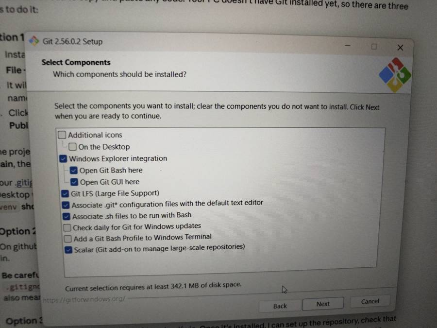
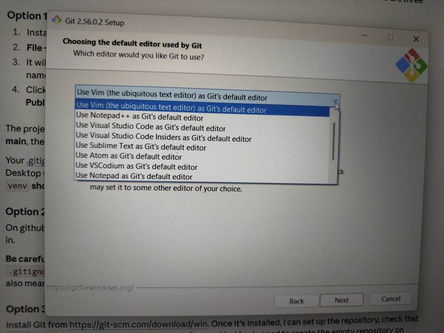
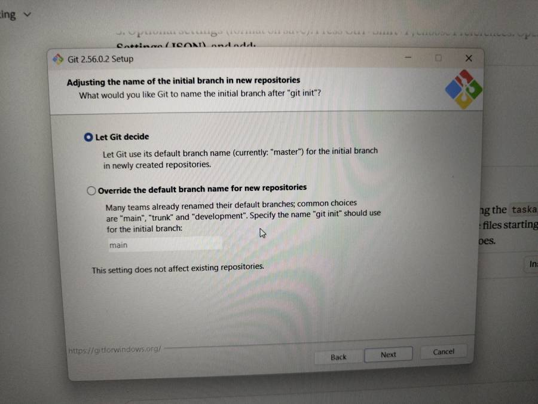
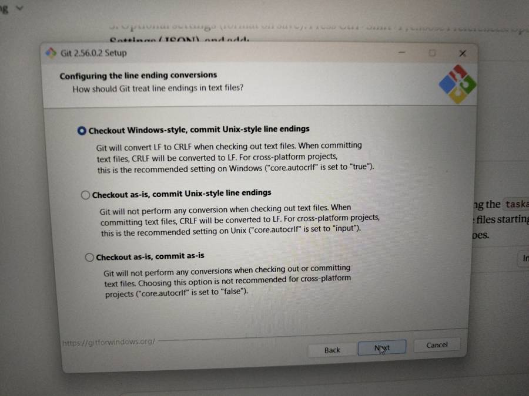
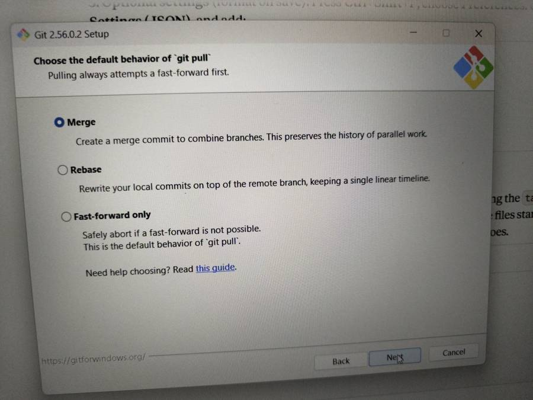
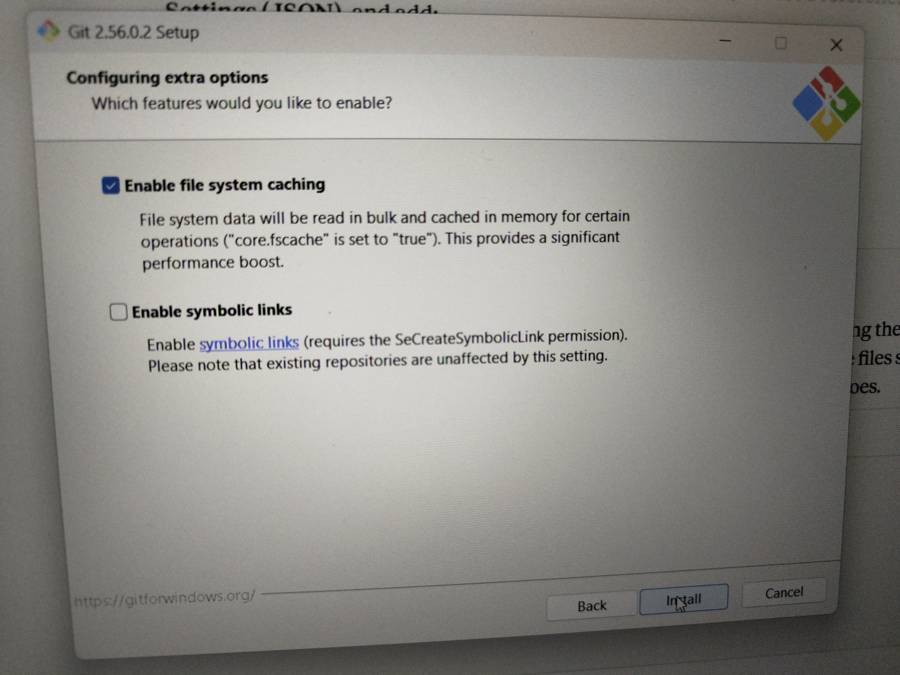

# Git Setup Guide for Windows (Git 2.56)

> 📚 Part of [dev-notes](../README.md)

A complete, step-by-step record of installing **Git for Windows** for GitHub work and software projects, with the reason behind every option.

> **Who this is for:** anyone setting up Git on Windows for GitHub, VS Code, and general development work.  
> **Version used:** Git for Windows 2.56.0.2, downloaded from https://git-scm.com/download/win

---

## Why Git for Windows?

Git for Windows is the official, standard Git distribution for Windows. It includes:

- **Git** itself (the version control engine)
- **Git Bash**, a Linux-style terminal for Windows
- **Git Credential Manager**, which handles secure sign-in to GitHub through your browser
- **Git LFS**, for large files like images, videos and datasets

It works with GitHub, GitLab, Bitbucket, VS Code and every major IDE, so it covers all GitHub work and software projects from one install.

---

## Part 1: Running the Installer

### Step 1: Select Components



| Option                                                            | Choice                 | Why                                                                                                               |
|-------------------------------------------------------------------|------------------------|----------------------------------------------|
| Additional icons / On the Desktop                                 | Optional               | Only adds a desktop shortcut. Not needed.                                                                         |
| Windows Explorer integration                                      | ✅ Keep                | Adds "Open Git Bash here" to the right-click menu of any folder, a quick way to open a terminal inside a project. |
| Git LFS (Large File Support)                                      | ✅ Keep                | Needed for repositories that store large files (images, models, datasets). Many GitHub projects use it.           |
| Associate .git\* configuration files with the default text editor | ✅ Keep                | Files like `.gitignore` open directly in your editor.                                                             |
| Associate .sh files to be run with Bash                           | ✅ Keep                | Lets you run shell scripts that many projects include.                                                            |
| Check daily for Git for Windows updates                           | Optional (recommended) | Keeps Git secure and current without you having to remember.                                                      |
| Add a Git Bash Profile to Windows Terminal                        | Optional (recommended) | Lets you open Git Bash as a tab inside Windows Terminal.                                                          |
| Scalar                                                            | ✅ Keep                | Speeds up very large repositories. Harmless if you never need it.                                                 |

Click **Next**.

### Step 2: Start Menu Folder

Leave the default (`Git`) and click **Next**.

**Why:** it only controls where shortcuts appear in the Start Menu. The default is fine.

### Step 3: Choosing the Default Editor



**Choice:** `Use Visual Studio Code as Git's default editor`

**Why:**

- Git opens this editor whenever it needs you to type something, such as a commit message or a merge message.
- The installer's default is **Vim**, which is hard for beginners: you can get stuck not knowing how to save or exit.
- VS Code is already installed, it is the most popular editor for GitHub work, and it has built-in Git support.
- If VS Code isn't installed, this option keeps **Next** greyed out. Pick **Notepad** instead in that case.

### Step 4: Name of the Initial Branch



**Choice:** `Override the default branch name for new repositories` → keep **`main`**

**Why:**

- Git's built-in default is still `master`, but **GitHub uses `main`** for every new repository.
- If your local branch is `master` and GitHub's is `main`, pushing creates two different branches and confusion.
- Matching both sides to `main` avoids that entirely.
- This only affects *new* repositories. Existing ones are unchanged.

### Step 5: Adjusting the PATH Environment

**Choice:** `Git from the command line and also from 3rd-party software` (Recommended)

**Why:**

- This makes `git` available in **PowerShell, Command Prompt, VS Code's terminal and other tools**, not only in Git Bash.
- VS Code, GitHub Desktop, IDEs and build tools all need to find Git on the PATH.
- The first option (Git Bash only) would make VS Code unable to find Git.
- The third option also replaces Windows tools like `find` and `sort` with Unix versions, which can break other programs.

### Step 6: Choosing the SSH Executable

**Choice:** `Use bundled OpenSSH`

**Why:** OpenSSH comes with Git, is tested with it, and works out of the box. You'd only pick an external SSH (like PuTTY's) if you already use one for something else.

### Step 7: Choosing the HTTPS Transport Backend

**Choice:** `Use the native Windows Secure Channel library`

**Why:**

- Git uses Windows' own certificate store to verify secure (HTTPS) connections.
- This works smoothly on home, school and office networks, including ones with company certificates or proxies.
- The OpenSSL option uses a separate certificate list and can fail on some networks.

### Step 8: Configuring Line Ending Conversions



**Choice:** `Checkout Windows-style, commit Unix-style line endings`

**Why:**

- Windows ends lines with **CRLF**, while Linux and macOS use **LF**.
- With this option, files look normal on your Windows PC (CRLF), but are saved to the repository with LF.
- Most GitHub projects are shared across operating systems, so this keeps everyone's files consistent.
- Without it, every line can appear "changed" in diffs just because of invisible line-ending characters.
- This is the officially recommended setting on Windows (`core.autocrlf=true`).

### Step 9: Configuring the Terminal Emulator

**Choice:** `Use MinTTY (the default terminal of MSYS2)`

**Why:** MinTTY gives Git Bash a resizable window, proper copy-paste, colours and Unicode support. The Windows console option is more limited. (This only affects the Git Bash window. VS Code uses its own terminal.)

### Step 10: Default Behaviour of `git pull`



**Choice:** `Merge`

**Why:**

- When you pull and both you and someone else have made changes, **Merge** combines them with a merge commit.
- It **never rewrites your commits**, so it is the safest choice while learning.
- **Rebase** gives a cleaner history but rewrites commits, which can be confusing if something goes wrong.
- **Fast-forward only** stops with an error whenever histories have diverged, which is frustrating for beginners.

### Step 11: Credential Helper

*(This screen may not appear in Git 2.56. Git Credential Manager is used automatically.)*

**Choice (if shown):** `Git Credential Manager`

**Why:**

- GitHub **no longer accepts your account password** for Git over HTTPS.
- Git Credential Manager opens your browser so you can sign in to GitHub once, then stores the login securely in Windows Credential Manager.
- After that, `git push` and `git pull` work without asking for passwords or tokens.

### Step 12: Configuring Extra Options



| Option                     | Choice       | Why                                                                                                            |
|----------------------------|--------------|-------------------------------------------|
| Enable file system caching | ✅ Keep      | Caches file information in memory, making commands like `git status` noticeably faster.                        |
| Enable symbolic links      | ❌ Leave off | Needs special Windows permissions and is rarely needed. Turning it on without the permission can cause errors. |

Click **Install**.

### Step 13: Experimental Options (if shown)

Leave everything **unchecked**.

**Why:** experimental features may be unstable. They are not needed for normal GitHub work.

### Step 14: Finish

Uncheck **View Release Notes** and click **Finish**.

---

## Part 2: First-Time Configuration

Open **VS Code**, press **Ctrl + \`** (backtick, below Esc) to open the terminal, and run:

```bash
git --version
git config --global user.name "Your Name"
git config --global user.email "your-email@example.com"
git config --global init.defaultBranch main
```

| Command                   | Why                                                                                                              |
|---------------------------|---------------------------------------------|
| `git --version`           | Confirms Git is installed and on the PATH.                                                                       |
| `user.name`               | Your name is attached to every commit you make.                                                                  |
| `user.email`              | Links your commits to your GitHub profile. **Must match an email on your GitHub account.**                       |
| `init.defaultBranch main` | Saves the `main` branch setting in your personal config too, as a backup to the installer's system-wide setting. |

### Verified result

```text
PS C:\Users\<you>> git --version
git version 2.56.0.windows.2

PS C:\Users\<you>> git config --global --list
core.editor="C:\Users\<you>\AppData\Local\Programs\Microsoft VS Code\bin\code" --wait
user.name=Your Name
user.email=your-email@example.com
```

> **Note:** settings chosen in the installer (branch name, line endings, credential manager) are stored in Git's **system** config, so they don't appear in `--global --list`. To see every setting and where it comes from, run:
>
> ```bash
> git config --list --show-origin
> ```

---

## Part 3: Connecting to GitHub

### Option A: Put an existing project on GitHub (VS Code)

1.  In VS Code, go to **File → Open Folder** and choose your project folder.
2.  Click the **Source Control** icon in the left sidebar.
3.  Click **Publish to GitHub** (or **Initialize Repository** first, then publish).
4.  Your browser opens once to sign in to GitHub. Approve it.
5.  Choose **public** or **private**, and VS Code creates the repository and uploads your code.

### Option B: Put an existing project on GitHub (command line)

First create an **empty** repository on github.com (no README, no .gitignore), then in your project folder:

```bash
git init
git add .
git commit -m "Initial commit"
git branch -M main
git remote add origin https://github.com/<your-username>/<repo-name>.git
git push -u origin main
```

### Option C: Download (clone) a project from GitHub

```bash
git clone https://github.com/<username>/<repo-name>.git
cd <repo-name>
code .
```

---

## Part 4: Daily Workflow Cheat Sheet

| Task                                    | Command                               |
|-----------------------------------------|---------------------------------------|
| See what changed                        | `git status`                          |
| See exact line changes                  | `git diff`                            |
| Stage all changes                       | `git add .`                           |
| Save a snapshot                         | `git commit -m "Describe the change"` |
| Upload to GitHub                        | `git push`                            |
| Download latest changes                 | `git pull`                            |
| View history                            | `git log --oneline`                   |
| Create and switch to a new branch       | `git switch -c feature-name`          |
| Switch branches                         | `git switch main`                     |
| Undo changes to a file (not yet staged) | `git restore <file>`                  |
| Unstage a file                          | `git restore --staged <file>`         |

**Good habits:**

- Always run `git pull` before starting work.
- Commit small, focused changes with clear messages.
- Add a `.gitignore` so files like `venv/`, `node_modules/`, `.env` and build output never get uploaded.
- Never commit passwords, API keys or `.env` files.

---

## Part 5: Troubleshooting

| Problem                                   | Fix                                                                                                                                         |
|-------------------------------------------|------------------------------------------------------------------------|
| `git` is not recognized                   | Close and reopen the terminal or VS Code. If it persists, re-run the installer and choose the recommended PATH option.                      |
| Push asks for a password                  | GitHub doesn't accept passwords. Make sure Git Credential Manager is in use: `git config --system credential.helper` should show `manager`. |
| Commits don't show on your GitHub profile | Your `user.email` doesn't match your GitHub email. Fix it with `git config --global user.email "your-github-email"`.                        |
| Push rejected (`non-fast-forward`)        | Someone pushed first. Run `git pull`, resolve any conflicts, then `git push`.                                                               |
| Stuck in a strange editor after a commit  | Probably Vim. Type `:wq` and press Enter to save and exit. Then set VS Code: `git config --global core.editor "code --wait"`.               |
| `master` vs `main` mismatch               | Rename your branch: `git branch -M main`.                                                                                                   |

---

*Setup completed and verified on October 13, 2026.*
